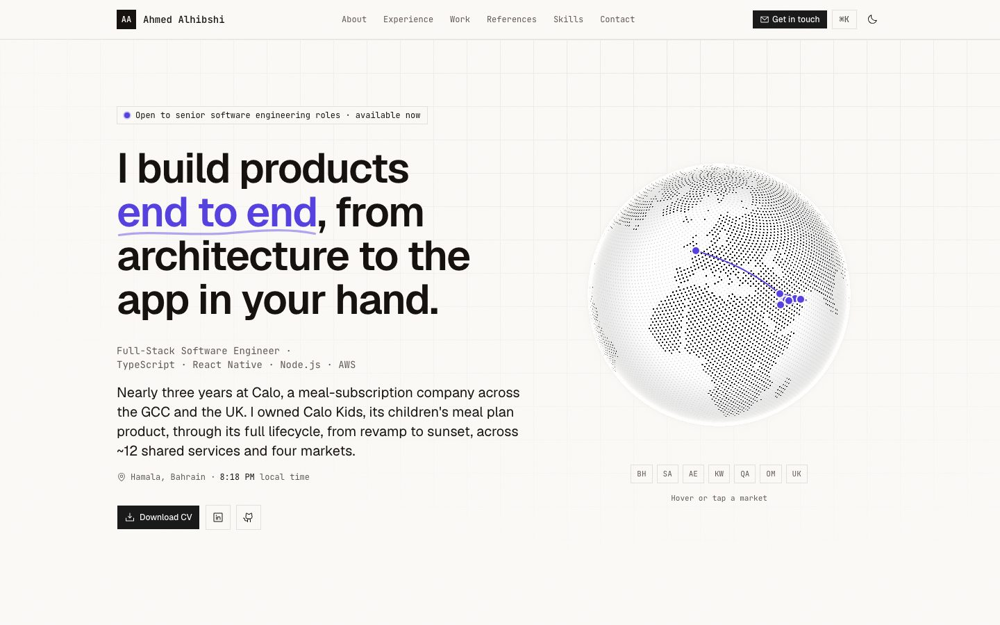
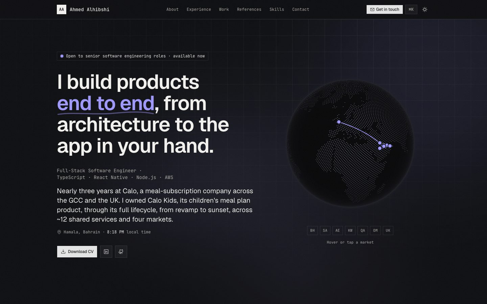

# Ahmed Alhibshi — Portfolio

[](https://github.com/aralhibshi/portfolio/actions/workflows/ci.yml)

**Live: [ahmedalhibshi.dev](https://ahmedalhibshi.dev)**

Personal portfolio of a full-stack software engineer: experience, selected production work, references and skills, with interactive visuals that explain how each project worked. Built with Next.js 16, React 19 and Tailwind CSS v4, and deployed as a fully static site on Vercel.

<p align="center">
  
  
</p>

## Highlights

- **Interactive project visuals.** A WebGL markets globe, a live migration pipeline, an age-ranged meal-sizing panel, a weight-projection chart with a story-style recap, and a feature-flag timeline, each explaining a real piece of work.
- **Fully static and fast.** Every route is prerendered; JavaScript ships only for the interactive pieces.
- **Accessible.** Keyboard and screen-reader equivalents for every interactive visual, and reduced-motion support throughout.
- **Tested.** Vitest unit tests for the pure logic, and Playwright end-to-end and automated accessibility (axe) tests against the production build at desktop and phone size, with CI on every push.

**Stack:** Next.js 16 (App Router) · React 19 · TypeScript (strict) · Tailwind CSS v4 · shadcn/ui · Motion · cobe · Vitest · Playwright · GitHub Actions · Vercel

## Technical decisions

- **Fully static.** Every route is prerendered at build time, so the site is served straight from Vercel's CDN with no server work per visit. Build-time values (the "Shipped" date and commit in the footer) come from the build itself.
- **Content separate from components.** All copy lives in one typed file, so updating the CV or a project never touches layout code.
- **Server Components by default.** Only interactive pieces (globe, command menu, story recap, career ladder, role list) ship JavaScript; everything else renders to plain HTML.
- **Animation that degrades gracefully.** Motion respects the visitor's reduced-motion setting, and the migration pipeline is pure SVG animation with no JavaScript. The WebGL globe loads only after the page, and stops rendering when off-screen.
- **Accessible by design.** Interactive visuals have keyboard and screen-reader equivalents (tabs, radio groups, live regions), and decorative layers are hidden from assistive tech.
- **Strict typing.** `strict` plus `noUncheckedIndexedAccess`; no `any`, type casts or non-null assertions in application code.
- **Quality gates.** Husky runs Prettier, ESLint, a type-check and the unit tests before every commit; CI on GitHub Actions checks formatting, lints, type-checks, runs the unit tests, builds, and runs the Playwright tests on every push and pull request.

## Project structure

```
src/
  app/                    routes, metadata, OG image, robots, sitemap
  content/
    site.ts               all page copy and data
    types.ts              the shapes of that content
  components/
    sections/             one folder per page section, holding everything only that section uses
      hero/               hero, markets globe + map, local time, use-cobe-globe hook
      about/              about, portrait
      experience/         experience, career ladder, role list
      work/               work, project visuals (meal sizing, pipeline, chart, story, timeline)
      references/         references, marker highlight
      skills/             skills, profile code card, tech icons
      contact/            contact
    layout/               page frame: header, footer, command menu, theme, background
    shared/               used by two or more sections: section shell, reveal, count-up, contact links
    ui/                   shadcn/ui primitives
  hooks/                  generic, reusable client hooks
  lib/                    pure logic and shared values, unit tested (globe maths, career dates, CV version)
tests/
  unit/                   Vitest
  e2e/                    Playwright
```

### Conventions

- **Colocate by use.** A component, or a hook, used by one section lives in that section's folder. It moves to `shared/` (or `hooks/`) only once a second place needs it, so removing a section never leaves orphans behind.
- **Logic out of components.** Anything worth unit testing is a pure function in `lib/`; components stay presentational, with stateful behaviour in hooks.
- **Copy out of components.** Text lives in `content/site.ts`, so content edits never touch layout code.
- **Kebab-case files, PascalCase components,** matching shadcn/ui and Next.js's own file conventions, and avoiding case-sensitivity bugs between macOS and Linux CI.
- **Conventional Commits and semantic versioning.** Releases are tagged with signed tags (`npm version`).

## Development

Requires Node.js 24.

```bash
npm install
npm run dev        # http://localhost:3000
npm run lint
npm run compile    # type-check
npm test           # Vitest unit tests
npm run build
npm run test:e2e   # Playwright and accessibility tests against the production build
```

The end-to-end tests need a browser once: `npx playwright install chromium`. If a dev server is already on port 3000, run them on another port: `E2E_PORT=3123 npm run test:e2e`.

## Editing content

All page copy (profile, section headings, experience, projects, references, skills) lives in [`src/content/site.ts`](src/content/site.ts), typed by [`src/content/types.ts`](src/content/types.ts). Components only render it.

The CV served by the site is [`public/ahmed-alhibshi-cv.pdf`](public/ahmed-alhibshi-cv.pdf). When replacing it, bump the minor version and date in [`src/lib/cv.ts`](src/lib/cv.ts) and stamp the PDF's metadata to match; an end-to-end test fails if the two disagree.

## Deployment

Vercel builds every push to `master`, and promotes it to production once CI passes. Vercel builds use the production address, `https://ahmedalhibshi.dev` (set in [`src/lib/site-url.ts`](src/lib/site-url.ts)), for canonical links, the sitemap and social previews; local builds use localhost, and `NEXT_PUBLIC_SITE_URL` overrides both.
